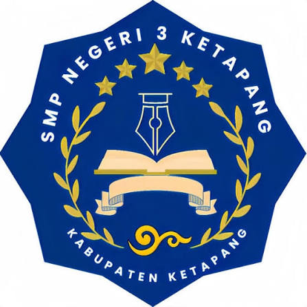

<div align="center">
  
  <h1>LMS Mandiri - SMPN 3 Ketapang</h1>
  <p><b>Platform Pembelajaran Digital Terpadu &amp; Mandiri Kurikulum Merdeka Fase D</b></p>

  <p>
    <a href="https://lms-ernawaty.vercel.app"></a>
    
    
    
    
    
  </p>
</div>

---

## 📌 Tentang Aplikasi

**LMS Mandiri SMPN 3 Ketapang** adalah platform *e-learning* modern yang dibangun untuk mendukung proses belajar mengajar mandiri siswa dan guru SMP Negeri 3 Ketapang, Kalimantan Barat. Menggabungkan kemudahan antarmuka aplikasi web progresif (*PWA Mobile-First*), kecerdasan buatan Google Gemini, tatap muka video interaktif ultra-low latency, dan sistem keamanan komunikasi terenkripsi end-to-end.

---

## ✨ Fitur-Fitur Unggulan

### 👨‍🏫 1. Pusat Komando Guru (Teacher Dashboard)
- **Dashboard Pemantauan**: Statistik real-time total siswa, rombel kelas, modul ajar, dan notifikasi kuis/tugas.
- **Generator Modul & Kuis AI**: Pembangkitan modul materi 4 bab otomatis dan bank soal pilihan ganda berbasis Google Gemini API (Multi-Key Round-Robin).
- **Editor Materi Dual-Mode WYSIWYG**: Mode visual ala Word atau Markdown dengan sinkronisasi instan.
- **Manajemen & Penilaian Tugas**: Tinjau pengumpulan berkas Cloudinary, beri nilai (0–100), dan input catatan evaluasi guru.
- **Pemantauan Progres Siswa**: Matriks centang real-time siswa yang telah menuntaskan pembacaan tiap bab materi.
- **Papan Pengumuman Sekolah**: Broadcast pengumuman penting/informasi berprioritas warna dengan target rombel kelas.
- **Impor & Ekspor Massal CSV**: Pendaftaran ratusan siswa otomatis dengan validasi NISN 10 digit.
- **Verifikasi Aktivasi Siswa**: Tinjau dan setujui/tolak permohonan klaim akun Google siswa baru.

### 👩‍🎓 2. Pengalaman Belajar Siswa (Student Experience)
- **Modul Bacaan Ramah Mata**: Tipografi bersih dengan forum diskusi materi bertingkat (*threaded discussion*).
- **Kuis Formatif Real-Time**: Hitung mundur waktu (*timer countdown*), pembahasan jawaban benar/salah, dan **Papan Peringkat Harian (Leaderboard)**.
- **Tatap Muka Online Virtual (Agora Live Meet)**: Video/Audio HD, lobi pra-meet kamera/mic, angkat tangan (*hand raise*), screen share, dan live chat.
- **Pesan Pribadi Terenkripsi End-to-End**: Enkripsi simetris Web Crypto API AES-GCM 256-bit antar siswa dengan status online (*presence*) dan typing indicator.
- **Pojok Literasi Mading**: Publikasi puisi, cerpen, pantun, artikel siswa lengkap dengan fitur apresiasi suka (*likes*) dan komentar.
- **Navigasi Mobile iOS Glassmorphism**: Bottom bar melayang ergonomis dan notifikasi meeting mengambang (*floating icon*) di atas navigasi.
- **PWA Ready**: Dukungan pemasangan aplikasi (*Install PWA*) ke layar utama HP dan tablet tanpa perlu download dari Play Store.

---

## 🛠️ Tech Stack & Integrasi

| Kategori | Teknologi |
| :--- | :--- |
| **Frontend** | React 18, Vite 5, Tailwind CSS 3.4, Radix UI Primitives, Lucide Icons, Framer Motion |
| **Database & Auth** | Firebase Authentication, Cloud Firestore (Real-Time NoSQL), Firebase Cloud Messaging (FCM) |
| **Media Cloud** | Cloudinary Upload Widget (dengan pemotongan crop gambar bawaan) |
| **Realtime RTC** | Agora RTC SDK NG (`agora-rtc-sdk-ng`, `agora-token`) |
| **Generative AI** | Google Gemini API (`@google/generative-ai`) dengan Failover Multi-Key Round Robin |
| **Kriptografi** | Web Crypto API (AES-GCM 256-bit & PBKDF2 hash) |
| **Format & Parsers** | React Markdown, Remark GFM, PapaParse CSV |

---

## 🚀 Panduan Memulai (Local Development)

### 1. Kloning Repository
```bash
git clone git@github.com:Genta-arya/lms-ernawaty.git
cd lms-ernawaty
```

### 2. Instalasi Dependensi
```bash
npm install
```

### 3. Konfigurasi Lingkungan (`.env`)
Salin berkas template lingkungan:
```bash
cp .env.example .env
```
Lengkapi variabel berikut di dalam `.env`:
```env
VITE_FIREBASE_API_KEY=AIzaSy...
VITE_FIREBASE_AUTH_DOMAIN=lsm-ernawaty.firebaseapp.com
VITE_FIREBASE_PROJECT_ID=lsm-ernawaty
VITE_FIREBASE_STORAGE_BUCKET=lsm-ernawaty.appspot.com
VITE_FIREBASE_MESSAGING_SENDER_ID=...
VITE_FIREBASE_APP_ID=...
VITE_FIREBASE_VAPID_KEY=...

# Agora Video RTC
VITE_AGORA_APP_ID=...

# Cloudinary Storage
VITE_CLOUDINARY_CLOUD_NAME=...
VITE_CLOUDINARY_UPLOAD_PRESET=...

# Google Gemini API
VITE_GEMINI_API_KEYS=key1,key2,key3,key4,key5,key6
VITE_GEMINI_MODEL=gemini-1.5-flash
```

### 4. Menjalankan Aplikasi
```bash
npm run dev
```
Aplikasi akan berjalan di `http://localhost:5173`.

---

## 📚 Dokumentasi Lengkap & Arsitektur

Untuk pengembang dan agen AI yang ingin mendalami arsitektur sistem, basis data, dan ide pengembangan ke depan, silakan pelajari dokumen di folder [`docs/`](./docs/):
- 📖 [**DOKUMENTASI_SISTEM.md**](./docs/DOKUMENTASI_SISTEM.md) — Rincian teknis 15 koleksi Firestore, 10 modul Dashboard Guru, alur bisnis aktivasi, enkripsi chat, dan standar kode.
- 🗺️ [**ROADMAP_DAN_IDE_PENGEMBANGAN.md**](./docs/ROADMAP_DAN_IDE_PENGEMBANGAN.md) — Matriks inovasi masa depan 3 fase (Ekspor Excel Raport, AI Tutor Murid, Papan Tulis Kolaboratif, Mode Offline PWA, dan Portal Orang Tua).

---

## 📄 Hak Cipta & Lisensi

Dikembangkan dengan dedikasi untuk **SMP Negeri 3 Ketapang**, Kalimantan Barat.  
Hak Cipta &copy; 2026 LMS Mandiri SMPN 3 Ketapang. Seluruh Hak Dilindungi.
